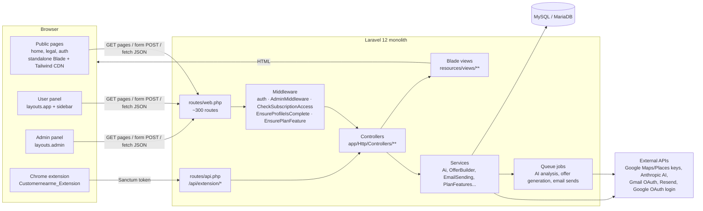

# 01 — Project Overview

> Audit date: 2026-11-17 · Repository: `customernearme_v2` (branch `main`, commit `4a3cc31`)
> Scope: read-only inspection. No application code was changed. Secrets in `.env*` were not read.
> Labels used: **[Confirmed]** = seen in code · **[Inferred]** = strong evidence, not directly stated · **[Unverified]** = could not be checked.

## 1. Identity

| Item | Finding |
|---|---|
| Product name | **CustomerNearme** (also rendered from the admin setting `site_name`, see `App\Models\Setting::get('site_name')` in every layout) [Confirmed] |
| Production URL | `https://v2.customernearme.com` (deploys from `main`). The marketing canonical URLs in `resources/views/home.blade.php` still point to `https://www.customernearme.com/` [Confirmed] |
| Purpose | B2B lead-generation SaaS: find businesses on Google Maps, save them as leads, manage them in a CRM-like "Lead Center", and run outreach (AI-written messages, Gmail / Resend email sending, campaigns, follow-ups, email analytics) [Confirmed — `home.blade.php` meta description, sidebar menu in `layouts/sidebar.blade.php`] |
| Business model | Paid subscription packages (monthly / yearly) with plan feature flags, a free trial, manual payment (upload a payment screenshot, admin approves) and an affiliate / referral programme [Confirmed — `user/subscription.blade.php`, `partials/payment-modal.blade.php`, `App\Services\PlanFeatures`, `AffiliateController`] |
| Target users | Freelancers, agencies and sales people who sell services to local businesses (web design, SEO, marketing etc.) [Inferred from home page copy and the AI Sales Profile] |
| Companion app | Chrome extension `Customernearme_Extension/` (Manifest V3, "CustomerNearMe - Google Maps Business Scraper" v2.0) that talks to `routes/api.php` `/api/extension/*` [Confirmed] |

## 2. User roles [Confirmed — `app/Models/User.php`]

| Role | How it is identified | Access |
|---|---|---|
| Admin | `user_type = admin` → `isAdmin()` | `/admin/*` (middleware `AdminMiddleware`), can switch into user view (`admin.switch.to.user`) |
| Individual user | `user_type = user` → `isUser()` | `/user/*` panel |
| Company owner | `user_type = company` → `isCompany()` | `/user/*` + Team Members, can filter data per team member (`components/user-filter.blade.php`) |
| Team member | `isTeamMember()` (user with `company_id`) | `/user/*` minus Subscription; works on the company owner's data (`getAccountOwner()`); cannot edit the AI Sales Profile (Gate `manage-sales-profile`, `app/Providers/AppServiceProvider.php:45`) |
| Guest | not logged in | Home, legal pages, auth pages, email unsubscribe, tracked links |

Further gating layered on top of roles:
- `CheckSubscriptionAccess` — users without an active subscription can only reach subscription/profile routes.
- `EnsureProfileIsComplete` — users without a WhatsApp number are sent to `user.profile`.
- `EnsurePlanFeature:<key>` — plan feature flags (e.g. `ai_sales_profile_enabled`, `gmail_sending_enabled`, `resend_campaigns_enabled`, `email_analytics_enabled`, `email_followups_enabled`). The sidebar hides links using the same flags (`PlanFeatures::enabled()`).
- `EnsureOfferBuilderInstalled` — Offer Builder routes need their migration.

## 3. Major modules

| Module | Routes prefix | Main view(s) |
|---|---|---|
| Marketing site | `/` | `home.blade.php`, `components/modern-hero.blade.php` |
| Legal pages | `/privacy-policy`, `/terms-and-conditions`, `/refund-policy` | `pages/*.blade.php` |
| Auth (login / signup / Google / reset / verify / account type) | `/auth*`, `/choose-account-type` | `auth/*.blade.php` |
| User dashboard | `/user/dashboard` | `user/dashboard.blade.php` |
| Find Leads (Google Maps search) | `/user/search*`, `/user/api/*` | `user/search.blade.php`, `user/search-history.blade.php` |
| My Leads (saved leads, folders, SEO check, export) | `/user/leads*`, `/user/folders*` | `user/leads.blade.php` (2,661 lines) |
| Lead Center (pipeline/CRM, import, conversations, coverage map, shared access) | `/user/lead-center*` | `user/lead-center/*` (21 files) |
| AI Sales Profile + Offers (Offer Builder) | `/user/ai-sales-profile*`, `/user/offer-builder/*` | `user/ai-sales-profile/*`, `user/offer-builder/*` |
| AI Outreach (AI lead analysis + drafts) | `/user/ai-outreach*` | `user/ai-outreach/*` |
| Email Sending (Gmail OAuth / Resend) | `/user/email-sending*` | `user/email-sending/*` |
| Campaigns + contacts + folder sends | `/user/campaigns*` | `user/campaigns/*` |
| Email Analytics + Follow-ups | `/user/email-analytics*`, `/user/email-follow-ups*` | `user/email-analytics/*`, `user/email-follow-ups/index.blade.php` |
| Subscription & payments | `/user/subscription*`, `/user/payment/submit` | `user/subscription.blade.php`, `partials/payment-modal.blade.php` |
| Affiliate | `/user/affiliate*` | `user/affiliate/*` |
| Team members, Profile, API keys, Tutorials, Feedback | `/user/team-members*`, `/user/profile*`, `/user/api-keys*`, `/user/tutorials*`, `/user/feedback*` | `user/*.blade.php` |
| Admin panel | `/admin/*` | `admin/**` (26 views on `layouts.admin`) |
| Extension API | `/api/extension/*` (Sanctum) | none (JSON) |
| AI engine & admin AI Setup | `/admin/ai-setup` | `admin/ai-setup/index.blade.php` — full AI coverage in `11-AI-FEATURES.md` |
| Outgoing email templates | — | `emails/*.blade.php` (12 files, out of scope for UI redesign) |

## 4. Architecture

- **Single Laravel 12 monolith**, server-rendered Blade templates. No SPA, no Livewire, no Inertia, no Alpine [Confirmed — 0 hits for `x-data`, `wire:`, `@livewire`, `Inertia`].
- **Rendering:** server-side Blade + progressive enhancement with inline vanilla JavaScript (`fetch`) and some jQuery (auth pages, search, leads, Select2). This is a **hybrid**: full page loads for navigation and GET filters, AJAX (`fetch`) for most actions, and HTML fragments returned by the server for a few widgets (e.g. `user.offer-builder.quick-form`, `user.offer-builder.offers.messages`).
- **Front controller:** the project root `index.php` + `.htaccess` (the project root is the web root on the host). Assets are therefore referenced as `asset('public/...')` everywhere — **must be preserved**.
- **Tenancy:** single database; data scoped per **account owner** (company owner + team members share data via `getAccountOwner()` and `ownedBy()` scopes). Not multi-tenant by domain.
- **Background work:** queues (`php artisan queue:listen`, `AnalysisLauncher::queue`) for AI generation, email sending and campaigns. UI uses **polling** for long jobs (no WebSockets).
- **AI:** Anthropic (default) or OpenAI via `App\Services\Ai\AiService`, chosen in Admin → AI Setup; AI jobs on a separate `ai` queue; monthly AI quotas per plan. See `11-AI-FEATURES.md`.
- **Localization:** none. English UI only; no `__()`/`@lang` usage [Confirmed].



## 5. Directory structure (relevant parts)

```
app/
  Http/Controllers/        root controllers + Admin/, AiOutreach/, AiSalesProfile/, EmailSending/,
                           EmailTracking/, OfferBuilder/, Outreach/, Resend/, Concerns/
  Http/Middleware/         role, subscription, plan-feature and profile gates
  Models/                  ~70 Eloquent models
  Services/                Ai/, OfferBuilder/, PlanFeatures, email services ...
resources/
  css/app.css              Tailwind v4 entry — NOT loaded by any page (see 02)
  js/app.js, bootstrap.js  axios bootstrap — NOT loaded by any page
  views/
    layouts/               app.blade.php (user), sidebar.blade.php, admin.blade.php
    partials/              payment-modal, feedback-modal, pricing-features, select2-assets, safe-html-helpers
    components/            modern-hero (+2 unused old versions), user-filter
    home.blade.php         marketing page (standalone HTML)
    auth/                  standalone HTML pages
    pages/                 legal pages (standalone HTML)
    user/                  user panel pages and partials (prefix "_" = partial)
    admin/                 admin panel pages
    emails/                transactional email templates
routes/web.php, api.php, console.php
public/assets/images/      logo.svg, white-logo.svg, logo.png, favicon.png, marketing images
Customernearme_Extension/  separate Chrome extension (own package.json)
tests/Feature, tests/Unit  PHPUnit (539 tests pass on 2026-11-17)
```

## 6. Entry points

| Entry | File |
|---|---|
| HTTP front controller | `index.php` (project root) |
| Web routes | `routes/web.php` (572 lines) |
| API routes | `routes/api.php` (extension only) |
| Scheduler / console | `routes/console.php` |
| User panel shell | `resources/views/layouts/app.blade.php` + `layouts/sidebar.blade.php` |
| Admin shell | `resources/views/layouts/admin.blade.php` |
| Vite entry (unused at runtime) | `vite.config.js` → `resources/css/app.css`, `resources/js/app.js` |
